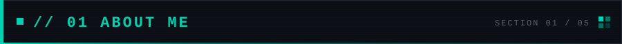
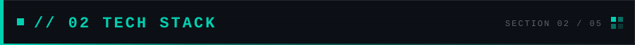
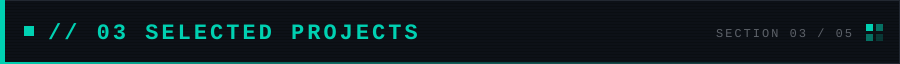
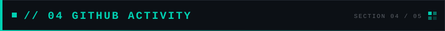
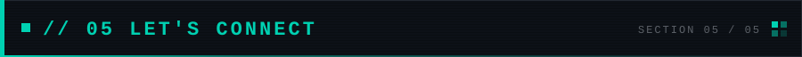
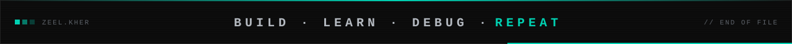

<!-- Zeel Kher — GitHub profile README · dark theme (#0D0D0D / #00D1B2) -->

  

  

  <b>Building ideas into reality.</b> 
  Information Technology student at Uka Tarsadia University, interested in software development, 
  backend engineering, databases, and building practical applications. 
  I learn by building projects, experimenting with technologies, and understanding how things work beneath the surface.

  

<b>FRONTEND</b>

  

<b>BACKEND</b>

  

<b>DATABASES & TOOLS</b>

  

| Project | Description | Technology |
|---|---|---|
| **CaptureCrew** | Photography booking marketplace | ASP.NET Core, C#, SQLite |
| **Doctor Appointment Management** | Doctor and appointment management system | PHP, MySQL |
| **QryInk** | QR code generation web project | Python, Django |
| **WifiQR** | Wi-Fi QR code generator | HTML, CSS, JavaScript |
| **FocusPause** | YouTube auto-pause Chrome extension | JavaScript |
| **OnlineBankSystem** | Console-based banking system | Java |

  
  

  

  

  
  &nbsp;
  
  &nbsp;
  
  &nbsp;
  

  

  

<b>INDEPENDENT MIND. CONTINUOUS ITERATIONS.</b>

